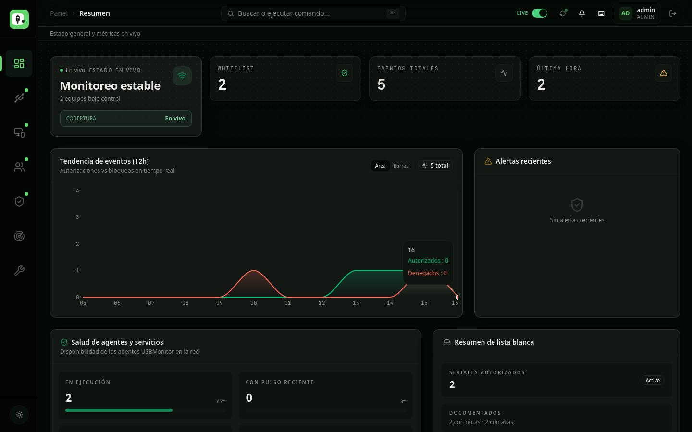
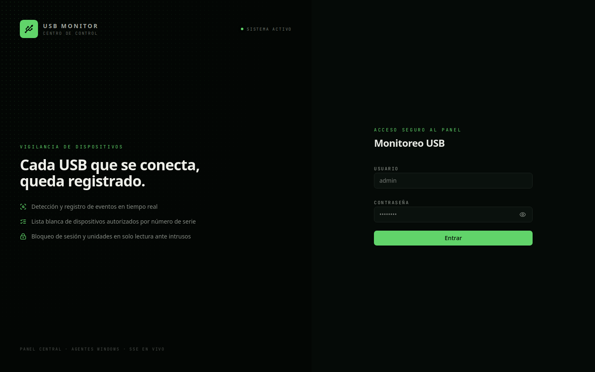
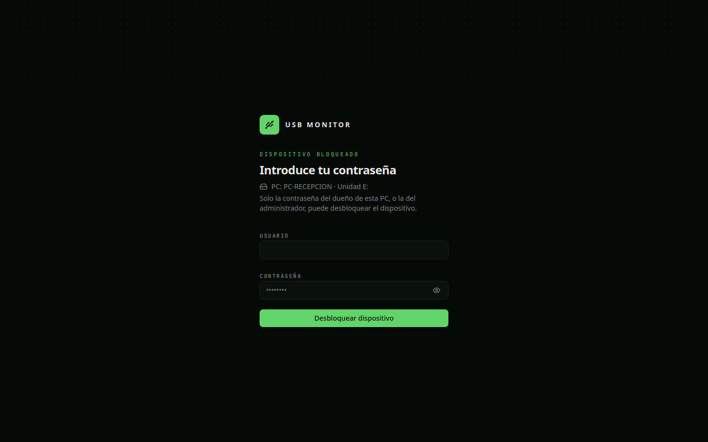

# USB Monitor

Sistema de monitoreo y control de dispositivos USB para una red local de PCs con Windows. Lo empecé en septiembre de 2025 para resolver un problema concreto: en una oficina nadie sabe qué memorias USB se conectan a cada computadora, ni quién las puso. Este sistema lo registra todo y, más importante, decide en el momento si ese dispositivo se puede usar o no.

Son dos piezas:

- **Un panel web** (Next.js + PostgreSQL) donde se ven los equipos, los eventos, la lista blanca de dispositivos y los usuarios.
- **Un agente para Windows** (Python, corre como servicio) que vigila las conexiones USB de cada PC, aplica las reglas y reporta al panel.

## Capturas

Panel de resumen, con los equipos y eventos en vivo:



La pantalla de acceso:



La página de desbloqueo, que es el respaldo cuando la ventana del agente no puede abrirse:



## Cómo funciona un bloqueo, paso a paso

Esto es lo que pasa de verdad cuando alguien conecta una memoria USB a una PC con el agente instalado:

1. El agente detecta la inserción por eventos de Windows (WMI), sin estar preguntando cada pocos segundos. También revisa lo que ya esté conectado al arrancar.
2. La unidad queda **bloqueada al momento**: se pone en solo lectura con `diskpart` mientras se decide. Antes el agente apagaba la PC en estos casos; lo quité, era una exageración que podía hacer perder trabajo a cualquiera.
3. Se consulta la lista blanca por número de serie:
   - **Si el dispositivo NO está en la lista blanca**, ahí termina todo. No hay contraseña que valga, ni siquiera la del administrador. En la pantalla del usuario sale un cartel avisando que el USB no está en la lista blanca y será bloqueado, y el evento queda registrado en el panel.
   - **Si SÍ está en la lista blanca**, toca el segundo factor: una ventana pide el usuario y la contraseña **del dueño de esa PC** (o la del administrador). Es decir, la lista blanca dice "este pendrive es conocido" y la contraseña comprueba "y tú eres quien debería estar usando esta computadora". Que un dispositivo sea conocido no basta, porque cualquiera puede tomar prestado un pendrive autorizado.
4. Si la contraseña es correcta, la unidad se libera y se puede usar **hasta que se extraiga**. Al volver a conectarla, se pide la contraseña de nuevo.
5. Todo queda registrado: conexiones, desconexiones, intentos de desbloqueo fallidos, intentos con la contraseña de otra persona (el sistema comprueba que la cuenta sea la dueña de esa PC, no vale la contraseña de un compañero) y desbloqueos correctos, con quién los hizo.

Detalles de implementación que me parecen importantes:

- Como el agente es un servicio de Windows (sesión 0), **no puede mostrar ventanas**. Por eso existe un proceso compañero aparte, `usb_prompt.py`, que corre en la sesión del usuario y es el que pinta la ventana de la contraseña. Ese proceso no decide nada: manda la contraseña directa al servidor y el servicio solo libera la unidad cuando el servidor se lo confirma por su propio canal. Si alguien cierra la ventana, no gana nada; el bloqueo lo mantiene el servicio. Y si cierra el proceso, el servicio lo vuelve a lanzar.
- Las contraseñas se verifican en el servidor con Argon2, con el mismo criterio que el login del panel: 5 intentos fallidos bloquean la cuenta 15 minutos.
- Cada usuario del panel tiene asignada su computadora. Ese vínculo es el que define quién es "el dueño" para el desbloqueo.

## El panel

- Resumen en vivo: equipos bajo control, eventos recientes, tendencia de autorizaciones y bloqueos, salud de los agentes.
- Lista de eventos con filtros, y lista blanca administrable (alta y baja de seriales con etiqueta y notas).
- Gestión de usuarios y de equipos, y asignación de cada usuario a su PC.
- Escáner de red para descubrir equipos y comprobar si tienen el agente instalado y corriendo.
- Instalación remota del agente por SSH o por WinRM, con el progreso en vivo en pantalla.

## Instalación

### El panel

Necesitas Node.js 20+ y un PostgreSQL accesible.

```bash
npm install
# crea un .env con DATABASE_URL y SESSION_SECRET
npx prisma db push     # crea las tablas
npm run db:seed        # datos iniciales (revisa prisma/seed.ts antes)
npm run dev            # desarrollo
npm run build          # producción (se sirve con el server.ts del repo)
```

El primer usuario administrador se crea con `npm run user:create`.

### El agente (en cada PC Windows)

Como administrador, dentro de la carpeta `USBMonitor`:

```powershell
.\install_dependencies.ps1
.\Install-Service.ps1
```

El instalador registra el servicio `USBMonitorService` con recuperación automática (si el servicio se cae, Windows lo reinicia al minuto) y deja programado el inicio del proceso compañero al iniciar sesión. La dirección del servidor se configura con las variables de entorno `USB_MONITOR_SERVER_HOST` y `USB_MONITOR_SERVER_PORT`.

## Estructura del repo

```
src/                 Panel (Next.js): páginas, API y lógica de servidor
prisma/              Esquema de la base de datos y migraciones
USBMonitor/          Agente Windows (servicio Python), compañero de
                     desbloqueo (usb_prompt.py) e instaladores
docs/capturas/       Las capturas de este README
INSPIRACION.md       Referencias de diseño de la interfaz
```

## Limitaciones, dichas claramente

- Esto es software en el espacio de usuario, no un driver. Un usuario con permisos de administrador local en su PC puede detener el servicio si sabe cómo. Lo que sí hace el sistema es **detectarlo**: cada equipo reporta su actividad y el panel marca los que dejan de dar señales, con la hora de la última señal. Detecta y deja evidencia; no lo impide.
- Si el servidor no responde, el agente mantiene bloqueado lo que no pueda verificar. Hoy los eventos generados sin red se pueden perder (la cola es en memoria); la cola persistente está en el plan de trabajo.
- El bloqueo por `diskpart` es a nivel de disco de solo lectura. El siguiente paso planeado es desactivar el dispositivo a nivel de PnP, que es más difícil de saltar.
- Solo Windows en el lado del agente. El panel corre donde corra Node.

## Estado del proyecto

Lo uso como proyecto personal y de aprendizaje, y está en desarrollo activo por ramas. La rama `desbloqueo-contrasena` trae el flujo de desbloqueo con contraseña descrito arriba. En la lista de pendientes: bloqueo a nivel de PnP, cola de eventos persistente para cuando no haya red, y una vista de auditoría de intentos dentro del panel.

Si algo de este README no coincide con lo que hace el código, el código manda y el README está mal: avísame en un issue.
