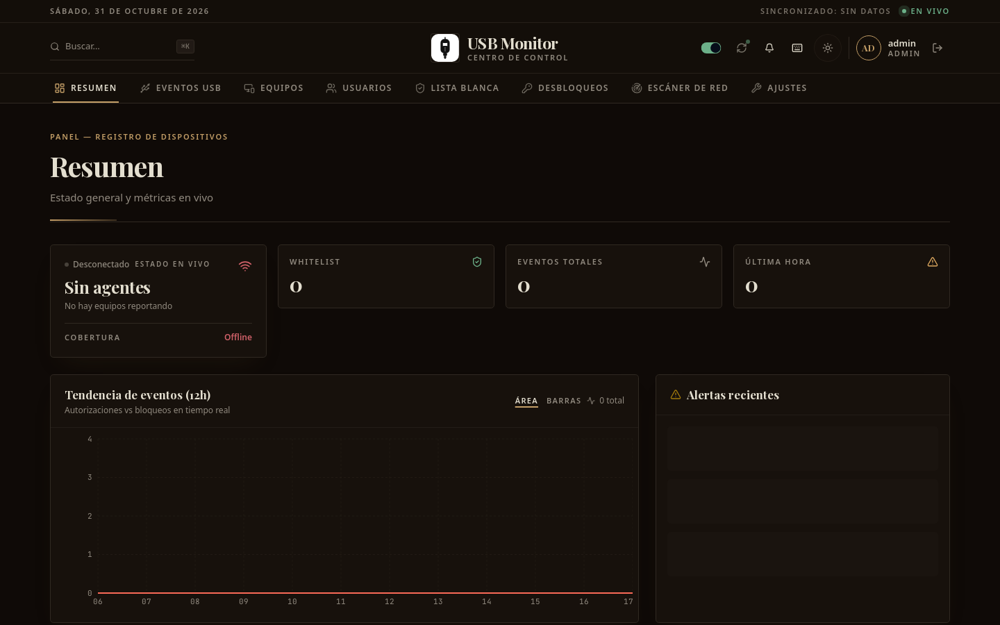
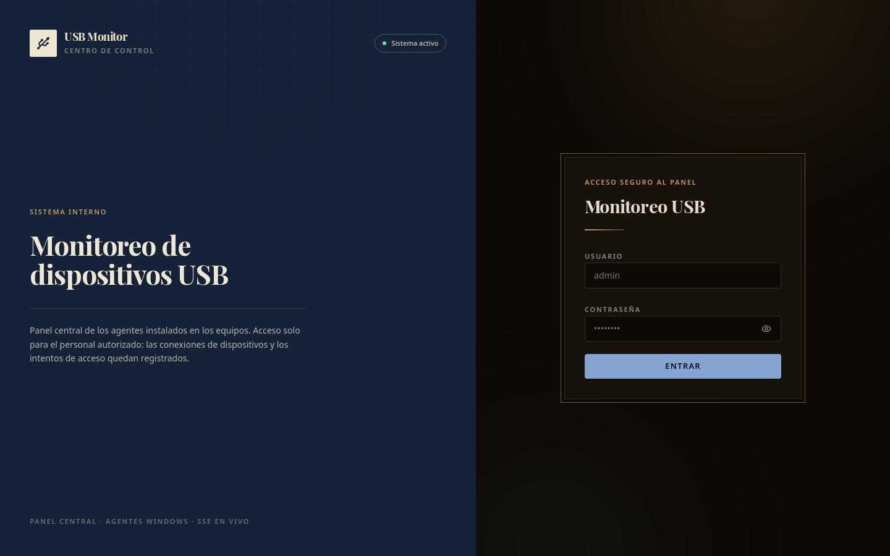
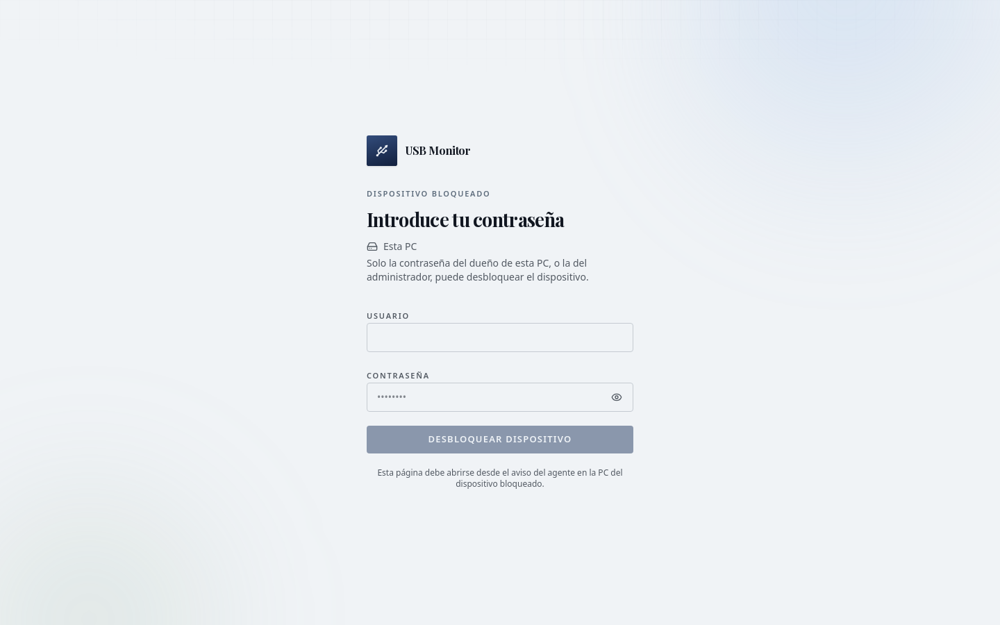

# USB Monitor

Sistema de monitoreo y control de dispositivos USB para una red local de PCs con Windows. Lo empecé en septiembre de 2025 para resolver un problema concreto: en una oficina nadie sabe qué se conecta a cada computadora, ni quién lo puso. Este sistema lo registra todo y, más importante, decide en el momento si ese dispositivo se puede usar o no.

Detecta memorias USB, discos duros y SSD externos (también los de carcasas modernas que Windows no presenta como «USB» a simple vista) y teléfonos móviles en modo de transferencia de archivos, que son las tres vías típicas de sacar datos de una PC.

Son dos piezas:

- **Un panel web** (Next.js + PostgreSQL) donde se ven los equipos, los eventos, la lista blanca de dispositivos y los usuarios.
- **Un agente para Windows** (Python, corre como servicio) que vigila las conexiones USB de cada PC, aplica las reglas y reporta al panel.

## Tecnologías

### Panel web

     

     

### Agente para Windows

       

## Capturas

Panel de resumen, con los equipos y eventos en vivo:



La pantalla de acceso:



La página de desbloqueo, que es el respaldo cuando la ventana del agente no puede abrirse:



## Cómo funciona un bloqueo, paso a paso

Esto es lo que pasa de verdad cuando alguien conecta un dispositivo a una PC con el agente instalado:

1. El agente detecta la inserción. En los discos lo sabe por eventos de Windows (WMI), sin estar preguntando cada pocos segundos; los móviles, las unidades ópticas (CD/DVD por USB, que Windows enumera aparte) y los adaptadores de red por USB no generan ese evento, así que un vigilante aparte los sondea cada pocos segundos. También revisa lo que ya esté conectado al arrancar. Un detalle importante: las carcasas de disco con puente moderno (UAS) se presentan como un disco SCSI genérico, igual que un disco interno SATA, así que el agente solo las trata como USB si comprueba que el dispositivo «padre» en el árbol de hardware es un puente USB. Los discos internos no se tocan nunca.
2. El dispositivo queda **bloqueado al momento**: se desactiva a nivel de dispositivo (PnP), que es el bloqueo fuerte. Si eso falla en un disco, se cae al respaldo de ponerlo en solo lectura con `diskpart`. Un teléfono no tiene letra de unidad, así que su único bloqueo posible es el de PnP. Antes el agente apagaba la PC en estos casos; lo quité, era una exageración que podía hacer perder trabajo a cualquiera.
3. Se consulta la lista blanca por número de serie (en un móvil, el serial que trae su identificador de dispositivo):
   - **Si el dispositivo NO está en la lista blanca**, ahí termina todo. No hay contraseña que valga, ni siquiera la del administrador. En la pantalla del usuario sale un cartel avisando que el dispositivo no está en la lista blanca y será bloqueado, y el evento queda registrado en el panel.
   - **Si SÍ está en la lista blanca**, toca el segundo factor: una ventana pide el usuario y la contraseña **del dueño de esa PC** (o la del administrador). Es decir, la lista blanca dice "este dispositivo es conocido" y la contraseña comprueba "y tú eres quien debería estar usando esta computadora". Que un dispositivo sea conocido no basta, porque cualquiera puede tomar prestado un pendrive autorizado.
4. Si la contraseña es correcta, el dispositivo se libera y se puede usar **hasta que se extraiga**. Al volver a conectarlo, se pide la contraseña de nuevo.
5. Todo queda registrado: conexiones, desconexiones, intentos de desbloqueo fallidos, intentos con la contraseña de otra persona (el sistema comprueba que la cuenta sea la dueña de esa PC, no vale la contraseña de un compañero) y desbloqueos correctos, con quién los hizo. El panel tiene una vista de auditoría solo de lectura con todo esto.

Detalles de implementación que me parecen importantes:

- Como el agente es un servicio de Windows (sesión 0), **no puede mostrar ventanas**. Por eso existe un proceso compañero aparte, `usb_prompt.py`, que corre en la sesión del usuario y es el que pinta la ventana de la contraseña. Ese proceso no decide nada: manda la contraseña directa al servidor y el servicio solo libera el dispositivo cuando el servidor se lo confirma por su propio canal. Si alguien cierra la ventana, no gana nada; el bloqueo lo mantiene el servicio. Y si cierra el proceso, el servicio lo vuelve a lanzar.
- Las contraseñas se verifican en el servidor con Argon2, con el mismo criterio que el login del panel: 5 intentos fallidos bloquean la cuenta 15 minutos.
- Cada equipo tiene su propio token de agente, y cada usuario del panel tiene asignada su computadora. Ese vínculo es el que define quién es "el dueño" para el desbloqueo.
- **Sin red no se pierde nada**: los eventos que no se pueden enviar se guardan en una cola en disco y se envían cuando vuelve la conexión, incluidos los arranques y paradas del servicio. Y si un dispositivo se conectó sin red, su bloqueo se registra en el servidor en cuanto hay conexión, para que la contraseña pueda verificarse entonces.
- **Emergencia sin red**: para las unidades con letra existe además una salida de emergencia cuando el servidor no responde: el agente guarda una copia cifrada de la contraseña del dueño y la página local del propio agente (`http://localhost:5001/desbloquear`) puede liberar la unidad con ella, con el mismo límite de intentos. Los intentos hechos así se suben al panel cuando vuelve la red. La página ofrece todos los bloqueos del equipo, también un móvil sin letra: al desbloquearlo sin red se reactiva su dispositivo, igual que con conexión.

## El panel

- Resumen en vivo: equipos bajo control, eventos recientes, tendencia de autorizaciones y bloqueos, salud de los agentes.
- Lista de eventos con filtros, y lista blanca administrable (alta y baja de seriales con etiqueta y notas).
- Vista de auditoría de desbloqueos: qué está bloqueado ahora, qué está en uso tras desbloquear, el historial de intentos y los equipos que han dejado de dar señales.
- Gestión de usuarios y de equipos, y asignación de cada usuario a su PC.
- Escáner de red para descubrir equipos y comprobar si tienen el agente instalado y corriendo.
- Instalación remota del agente por SSH o por WinRM, con el progreso en vivo en pantalla.
- Ajustes del desbloqueo por contraseña: interruptor general, emergencia sin red, token por equipo, bloqueo de la sesión al conectar y minutos de silencio para marcar un equipo como caído. Esos dos ajustes de equipo se empujan al guardarlos y, además, cada agente los pide él mismo al arrancar y periódicamente, para que un equipo apagado en el momento del cambio no se quede con los viejos.
- La navegación se puede poner en la cabecera superior o en una barra lateral, a elegir en Ajustes.

## Instalación

### El panel

Necesitas Node.js 20+ y un PostgreSQL accesible.

```bash
npm install
# crea un .env con DATABASE_URL y SESSION_SECRET
npx prisma migrate deploy   # crea las tablas (migración base)
# Si tu base de datos ya existía de antes de la migración base:
#   npx prisma migrate resolve --applied 20250101000000_baseline
npm run db:seed        # datos iniciales (revisa prisma/seed.ts antes)
npm run dev            # desarrollo
npm run build          # producción (se sirve con el server.ts del repo)
```

El primer usuario administrador se crea con `npm run user:create`.

### El agente (en cada PC Windows)

Como administrador, dentro de la carpeta `USBMonitor`:

```powershell
.\install_dependencies.ps1
.\Install-Service.ps1
```

El instalador registra el servicio `USBMonitorService` con recuperación automática (si el servicio se cae, Windows lo reinicia al minuto), deja programado el inicio del proceso compañero al iniciar sesión y genera el token propio de ese equipo. La dirección del servidor se configura con las variables de entorno `USB_MONITOR_SERVER_HOST` y `USB_MONITOR_SERVER_PORT`. La herramienta `usb_monitor_admin.py` sirve para configurar la clave API del agente a mano cuando hace falta, y `build_usb_prompt_pyinstaller.ps1` compila el proceso compañero a ejecutable.

## Estructura del repo

```
src/                 Panel (Next.js): páginas, API y lógica de servidor
prisma/              Esquema de la base de datos y migraciones
USBMonitor/          Agente Windows (servicio Python), compañero de
                     desbloqueo (usb_prompt.py), herramienta de
                     administración (usb_monitor_admin.py), tests
                     (USBMonitor/tests) e instaladores
docs/capturas/       Las capturas de este README
INSPIRACION.md       Referencias de diseño de la interfaz
```

## Limitaciones, dichas claramente

- Esto es software en el espacio de usuario, no un driver. Un usuario con permisos de administrador local en su PC puede detener el servicio si sabe cómo. Lo que sí hace el sistema es **detectarlo**: cada equipo reporta su actividad y el panel marca los que dejan de dar señales, con la hora de la última señal, distinguiendo si el que cayó fue el agente o el servidor entero. Detecta y deja evidencia; no lo impide.
- Si el servidor no responde, el agente mantiene bloqueado lo que no pueda verificar. Los eventos no se pierden (cola persistente en disco), y la contraseña en línea se puede verificar en cuanto la conexión vuelve; mientras tanto queda la emergencia local descrita arriba.
- Si en un móvil la desactivación por PnP fallara en una PC concreta, no hay un segundo mecanismo: el evento llega al panel marcado como «sin bloqueo efectivo» en vez de fingir un bloqueo que no existe.
- Un móvil en modo «solo carga» no expone datos y Windows ni siquiera lo enumera como dispositivo de archivos: el agente lo caza en el momento en que alguien activa la transferencia.
- Un adaptador de red por USB que ya esté conectado al arrancar el servicio (típico: el dock que le da red al propio equipo) se registra pero no se bloquea, para no dejar a la PC sin su conexión; los que se conecten después sí se bloquean.
- Solo Windows en el lado del agente. El panel corre donde corra Node (el escáner de red usa el `ping` del sistema: su sintaxis está ajustada a Windows).

## Estado del proyecto

Lo uso como proyecto personal y de aprendizaje, y está en desarrollo activo. Todo lo descrito aquí está fusionado en `main`. Lo que queda por hacer de verdad es de banco de pruebas, no de código: correr el sistema contra hardware variado (más carcasas de disco, más teléfonos) y ajustar lo que la práctica enseñe.

Si algo de este README no coincide con lo que hace el código, el código manda y el README está mal: avísame en un issue.
