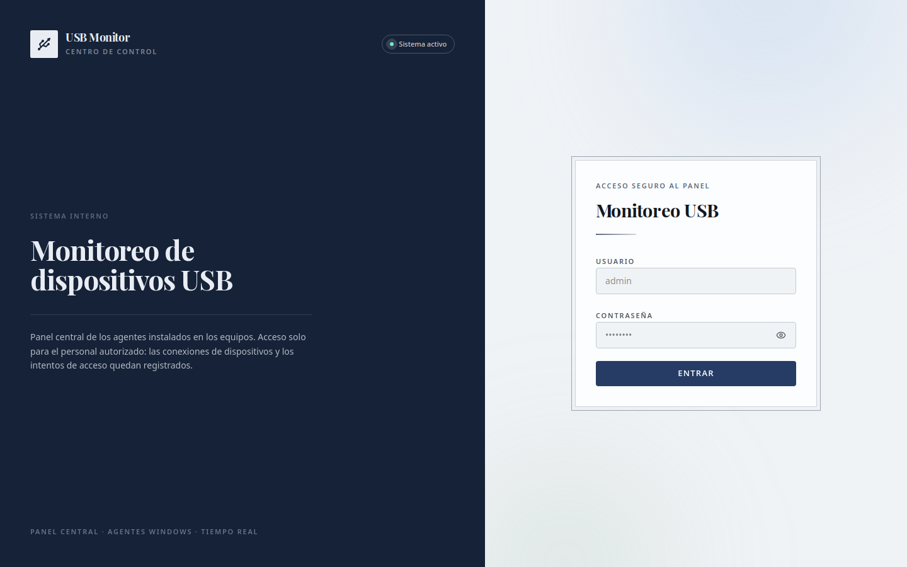
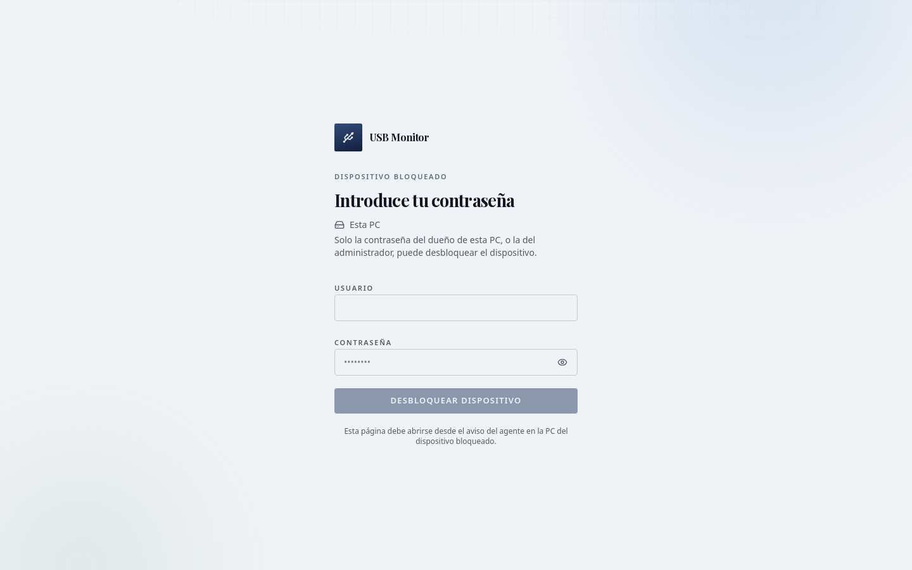

# USB Monitor

Sistema de monitoreo y control de dispositivos USB para una red local de PCs con Windows. Lo empecé en septiembre de 2025 para resolver un problema concreto: en una oficina nadie sabe qué se conecta a cada computadora, ni quién lo puso. Este sistema lo registra todo y, más importante, decide en el momento si ese dispositivo se puede usar o no.

Detecta memorias USB, discos duros y SSD externos (también los de carcasas modernas que Windows no presenta como «USB» a simple vista) y teléfonos móviles en modo de transferencia de archivos, que son las tres vías típicas de sacar datos de una PC. También ve unidades ópticas USB, adaptadores de red USB e impresoras, aunque esas no se bloquean: quedan registradas y nada más.

Son dos piezas:

- **Un panel web** (Next.js + PostgreSQL) donde se ven los equipos, los eventos, la lista blanca de dispositivos y los usuarios. Se puede instalar a mano o con un **instalador para Windows** que lo deja todo montado, sin pedir nada antes (ver «Instalación»).
- **Un agente para Windows** en C# (.NET 10): un único ejecutable autocontenido, `USBMonitorService.exe`, que hace de servicio, de ventana de gestión y de ventana de contraseña según cómo se le llame. Vigila las conexiones USB de cada PC, aplica las reglas y reporta al panel. (El agente original era en Python; lo reescribí en C# a principios de noviembre de 2026 y el de Python ya no se usa.)

Las versiones del agente y del instalador del panel se compilan solas con GitHub Actions y se publican en la pestaña **Releases** de este repo: etiquetas `agente-v*` para el agente y `panel-v*` para el instalador. Al escribir esto, las últimas son el agente **v2.1.1** y el panel **v1.5.6**.

## Tecnologías

### Panel web

     

      

### Agente para Windows

    

## Requisitos

### El equipo del panel (con el instalador)

- **Windows 10 u 11 de 64 bits** (o un Windows Server equivalente), con permisos de administrador para instalar.
- **Unos 2 GB de disco libres**: alrededor de 1 GB para el programa (el panel, Node, PostgreSQL, Redis y la bandeja) y el resto para la base de datos y las copias semanales, que crecen con el uso.
- **2 GB de RAM como mínimo; 4 GB recomendados**: en el mismo equipo conviven el panel, PostgreSQL y Redis.
- **Red local**: los agentes y los navegadores llegan al panel por su puerto (3000 por defecto).
- **No hace falta tener nada instalado antes**: ni Node, ni PostgreSQL, ni Redis, ni .NET. El instalador es completo y funciona sin conexión, todo viaja dentro. Internet solo hace falta para descargarlo.
- El equipo debe quedar **encendido** mientras se quiera vigilar la red. Si el panel se apaga, los agentes siguen bloqueando con lo último que sabían y guardan los eventos en su cola hasta que vuelva.

### Cada PC con agente

- **Windows 10 u 11 de 64 bits**.
- **Permisos de administrador para instalarlo** (registra un servicio de Windows). Para el uso diario, ningún permiso especial.
- **Unos 200 MB de disco**. No necesita .NET instalado: el ejecutable es autocontenido.
- **Red con el equipo del panel**: tiene que alcanzar su puerto (3000 por defecto) por HTTP.
- **El reloj razonablemente en hora**: las peticiones del agente van firmadas y la firma admite una desviación de ±5 minutos; además, el agente aprende el desfase a partir de las respuestas del propio panel.

### Para instalar el agente a distancia (desde el panel)

- La red del equipo destino en perfil **Privado** y la **compartición de archivos activa**: el empuje va por SMB (puerto 445) al recurso administrativo `C$`.
- Una **cuenta administradora local de ese equipo, con contraseña**. En esta red cada PC tiene la suya y nunca se comparten: la tarea de instalación admite una credencial distinta por equipo, y la contraseña solo vive en la memoria del panel mientras dura la tarea.

### El panel a mano (sin instalador) y para desarrollar

- **Node.js 22** y npm (el instalador lleva el Node 22.14).
- **PostgreSQL accesible** (el instalador monta el 17.5 como clúster propio; a mano vale el que haya, con su cadena en `DATABASE_URL`).
- **Redis, opcional a mano**: si se define `REDIS_URL`, el panel lo usa para la presencia de los agentes y los límites de intentos; sin él funciona igual, con memoria interna. Con el instalador viene integrado y ya configurado.
- Para compilar el agente y la bandeja hace falta el **SDK de .NET 10**; para construir el instalador, **Inno Setup 6** y PowerShell. El constructor se descarga lo que falte (PostgreSQL, Node, WinSW, Redis) en la máquina de construcción: ahí sí hace falta internet.

### Puertos, en resumen

| Puerto | Qué es | Quién lo alcanza |
|---|---|---|
| 3000 (configurable) | El panel web y la API de los agentes | La red local |
| 5433 (configurable) | El PostgreSQL integrado | Solo el propio equipo |
| 6381 (fijo) | El Redis integrado | Solo el propio equipo |
| 445 | SMB, para el empuje de las instalaciones remotas | El panel y el equipo destino, solo durante la instalación |
| 5001 | La página local de emergencia del agente | Solo la propia PC del agente |

## Capturas

Panel de resumen, con los equipos y eventos en vivo:


La pantalla de acceso:



La página de desbloqueo, que es el respaldo cuando la ventana del agente no puede abrirse:



## Cómo funciona un bloqueo, paso a paso

Esto es lo que pasa de verdad cuando alguien conecta un dispositivo a una PC con el agente instalado:

1. El agente detecta la inserción sondeando el hardware cada 1,5 segundos, y también revisa lo que ya esté conectado al arrancar. Un detalle importante: las carcasas de disco con puente moderno (UAS) se presentan como un disco SCSI genérico, igual que un disco interno SATA, así que el agente solo las trata como USB si comprueba que un dispositivo «padre» en el árbol de hardware (hasta tres niveles) es un puente USB. Los discos internos no se tocan nunca. Las impresoras USB se detectan y se registran, pero **nunca se bloquean ni piden contraseña**; los adaptadores de red USB que ya estén conectados al arrancar tampoco se bloquean, para no dejar a la PC sin su propia conexión.
2. El dispositivo queda **bloqueado al momento**, por capas, y cada capa se comprueba antes de darla por buena:
   - Primero se intenta desactivar el dispositivo (PnP) y se confirma que Windows lo dejó desactivado de verdad. En discos duros externos cuyo nodo se resiste, se pasa al nodo USB del propio dispositivo, nunca al concentrador raíz.
   - Si el PnP no cede, se bloquea y desmonta el volumen (todas las particiones, no solo la primera letra).
   - Como último respaldo, el disco se pone en solo lectura con `diskpart` (ese deja leer: es un bloqueo degradado y queda dicho en el registro).
   Un teléfono no tiene letra de unidad, así que su bloqueo es el de PnP.
3. Se consulta la lista blanca por número de serie (en un móvil, el serial que trae su identificador de dispositivo):
   - **Si el dispositivo NO está en la lista blanca**, ahí termina todo. No hay contraseña que valga, ni siquiera la del administrador. En la pantalla del usuario sale un cartel avisando que el dispositivo no está en la lista blanca, y el evento queda registrado en el panel. Como ajuste opcional (desactivado por defecto) se puede hacer que la PC inicie el apagado de Windows con 60 segundos de margen ante un dispositivo desconocido conectado después del arranque; extraerlo o desbloquearlo cancela la cuenta atrás.
   - **Si SÍ está en la lista blanca**, toca el segundo factor: una ventana pide la contraseña **del dueño de esa PC** (o la del administrador). Es decir, la lista blanca dice "este dispositivo es conocido" y la contraseña comprueba "y tú eres quien debería estar usando esta computadora". Que un dispositivo sea conocido no basta, porque cualquiera puede tomar prestado un pendrive autorizado. Hay un modo «solo administradores» que limita el desbloqueo a las cuentas administradoras.
4. Si la contraseña es correcta, el dispositivo se libera y se puede usar **hasta que se extraiga**. Al volver a conectarlo, se pide la contraseña de nuevo.
5. Todo queda registrado: conexiones, desconexiones, intentos de desbloqueo fallidos, intentos con la contraseña de otra persona (el sistema comprueba que la cuenta sea la dueña de esa PC, no vale la contraseña de un compañero) y desbloqueos correctos, con quién los hizo. El panel tiene una vista de auditoría solo de lectura con todo esto.

Detalles de implementación que me parecen importantes:

- Como el agente es un servicio de Windows (sesión 0), **no puede mostrar ventanas**. Por eso el mismo ejecutable tiene un modo compañero que corre en la sesión del usuario y es el que pinta la ventana de la contraseña. Ese proceso no decide nada: manda la contraseña directa al servidor y el servicio solo libera el dispositivo cuando el servidor se lo confirma. El compañero arranca oculto y solo aparece cuando hay un bloqueo; cerrar su ventana con la X solo lo oculta, y si alguien mata el proceso, el servicio lo vuelve a lanzar en la sesión activa. Si el panel no responde, el registro del bloqueo se reintenta hasta que quede hecho, para que el desbloqueo en línea sea posible en cuanto vuelva la conexión.
- **Sin huella**: cada cambio persistente que el agente hace en la PC (desactivar un dispositivo, solo lectura, etc.) queda anotado con su valor original, y se revierte al extraer el dispositivo, al parar el servicio, al desinstalar y tras un reinicio sucio. Lo que el agente tocó, el agente lo deja como estaba.
- El ejecutable es una aplicación de ventanas: no abre ninguna consola al ejecutarse, ni como servicio ni en sus ventanas.
- Las contraseñas se verifican en el servidor, con el mismo criterio que el login del panel: 5 intentos fallidos bloquean la cuenta 15 minutos.
- Cada equipo tiene su propia **credencial criptográfica**: un par de claves ECDSA P-256 que se genera en la propia PC. La clave privada nunca sale de ahí (se guarda cifrada con DPAPI en `server.json`) y el panel solo conserva la pública y su huella; cada petición del agente va firmada. El alta se hace con un **código de enrolamiento de un solo uso** que se genera en el panel y caduca. Y si la misma credencial apareciera desde dos direcciones IP distintas en diez minutos, el panel la revoca sola y levanta una alerta: eso es lo que delata un equipo clonado. La clave API de usuario ya no sirve para que un agente se autentique.
- Cada usuario del panel tiene asignada su computadora (la asignación se hace por equipo, no por IP). Ese vínculo es el que define quién es "el dueño" para el desbloqueo.
- **Sin red no se pierde nada**: los eventos que no se pueden enviar se guardan en una cola en disco y se envían cuando vuelve la conexión, incluidos los arranques y paradas del servicio.
- **Emergencia sin red**: existe además una salida de emergencia cuando el servidor no responde: el agente guarda una copia cifrada de la contraseña del dueño y la página local del propio agente (`http://localhost:5001/desbloquear`) puede liberar la unidad con ella, con un máximo de 5 intentos locales cada 15 minutos. Los intentos hechos así se suben al panel cuando vuelve la red.

## El panel

- Resumen en vivo: equipos bajo control, eventos recientes, tendencia de autorizaciones y bloqueos, salud de los agentes. Casi todo llega **en tiempo real** por Socket.IO: eventos, bloqueos nuevos, intentos y cambios de lista blanca o de usuarios empujan la actualización a las pantallas abiertas sin esperar al siguiente sondeo.
- Lista de eventos con filtros, y lista blanca administrable (alta y baja de seriales con etiqueta y notas).
- Vista de auditoría de desbloqueos: qué está bloqueado ahora, qué está en uso tras desbloquear, el historial de intentos y los equipos que han dejado de dar señales. Un equipo se considera «conectado» solo si su última señal es reciente (el umbral se ajusta en el panel); el resto es evidencia por silencio.
- Los dispositivos se etiquetan por tipo en todas las listas: memoria/disco, teléfono, óptica USB, red USB o impresora, también cuando no tienen letra de unidad.
- Gestión de usuarios y de equipos, asignación de cada usuario a su PC, y generación del código de enrolamiento de cada equipo desde su propia ficha.
- **Evidencia por bloqueo**: ante un dispositivo fuera de la lista blanca, el agente puede guardar una foto de la pantalla de ese instante (una por cada conexión del dispositivo), la ventana que estaba delante, los procesos y las pestañas del navegador. En el panel se consulta desde el propio bloqueo, con su cadena de custodia: huella SHA-256 de la imagen y registro de quién la ha visto y cuándo.
- **Escalera ante reincidentes y apagado cancelable**: el apagado ante desconocidos puede subir de nivel por dispositivo (primera vez aviso, segunda bloqueo de la sesión, tercera apagado), y una cuenta atrás en curso se puede detener desde el panel; el usuario de la PC ve la cuenta atrás en su pantalla.
- Escáner de red para descubrir equipos y comprobar si tienen el agente instalado y corriendo.
- Tareas de instalación remota con el progreso en vivo: a los equipos que ya tienen agente, actualización por su propio canal con verificación SHA-256; a los que no, empuje SMB estilo Kaspersky (el ayudante del panel copia el ejecutable al recurso `C$` y un servicio temporal lo instala en su modo sin ventanas), con la comprobación de requisitos en vivo contra cada destino y la receta de preparación del equipo (red en perfil Privado, compartición activa, administrador local con contraseña y token completo en remoto).
- **Guía interactiva** que recorre las pantallas del panel paso a paso y sección de **preguntas frecuentes**; se puede reactivar desde Ajustes.
- Ajustes del desbloqueo por contraseña: interruptor general, emergencia sin red, modo solo administradores, apagado ante dispositivos desconocidos, bloqueo de la sesión al conectar y minutos de silencio para marcar un equipo como caído. Los cambios se empujan a los agentes conectados y, además, cada agente los pide él mismo al arrancar y periódicamente, para que un equipo apagado en el momento del cambio no se quede con los viejos.
- **Redis** integrado en el instalador, para que la presencia de los agentes y los límites de intentos sobrevivan a un reinicio del panel; a mano, basta con definir `REDIS_URL`.
- La navegación se puede poner en la cabecera superior o en una barra lateral, a elegir en Ajustes.

## Instalación

### El panel, con el instalador (la vía corta)

Descarga el instalador de la pestaña **Releases** (etiquetas `panel-v*`; la última es la **1.5.6**) y ejecútalo como administrador en la PC que hará de servidor. Hay tres archivos por versión:

- `USBMonitor-Panel-<versión>.exe` — el instalador normal.
- `USBMonitor-Panel-<versión>-completo.exe` — el mismo, con el paquete del agente dentro: las instalaciones remotas funcionan desde el primer minuto.
- `USBMonitor-Panel-<versión>-actualizacion.exe` — solo el programa, para aplicar sobre una instalación existente cuando no cambian PostgreSQL, Node ni Redis.

El asistente, en español, te pide el puerto del panel, el puerto de la base de datos y el usuario y la contraseña del primer administrador, e instala todo como servicios de Windows (con WinSW): PostgreSQL como clúster propio, Redis integrado, Node.js y el panel, más una copia semanal de la base de datos y una **bandeja** junto al reloj para abrir el panel y parar, iniciar o reiniciar su servicio. Los datos quedan en `C:\ProgramData\USBMonitor`. No hace falta tener nada instalado antes, y el instalador no usa la red para nada: todo viaja dentro. Actualizar es ejecutar el instalador nuevo encima: los datos, las cuentas y los ajustes se conservan. Desinstalar, en cambio, lo borra todo, datos incluidos: desinstalar es empezar de cero. El detalle completo del instalador está en `instalador/LEEME.md`.

Para actualizar un panel instalado compilando desde este repo (sin descargar el paquete de actualización) está `instalador/Actualizar-Panel.ps1`: hace `git pull`, compila y aplica el programa nuevo sobre la instalación, sin tocar su `.env`, sus ajustes ni su paquete del agente.

### El panel, a mano

Necesitas Node.js 22 y un PostgreSQL accesible. En producción, además, Redis si defines `REDIS_URL`.

```bash
npm install
# crea un .env con DATABASE_URL y SESSION_SECRET
npx prisma migrate deploy   # crea las tablas (migración base)
# Si tu base de datos ya existía de antes de la migración base:
#   npx prisma migrate resolve --applied 20250101000000_baseline
npm run db:seed        # datos iniciales (revisa prisma/seed.ts antes)
npm run build          # producción: hay que compilar ANTES de arrancar
npm run start          # sirve el panel (server.ts del repo) en el puerto 3000
npm run dev            # desarrollo
```

El primer usuario administrador se crea con `npm run user:create`. Después del primer `git pull` tras cambios de esquema, corre `npm run db:push` si el propio panel te lo pide en sus notas de versión.

### El agente (en cada PC Windows)

Descarga el zip del agente de la pestaña **Releases** (etiquetas `agente-v*`), descomprime `USBMonitorService.exe` en una carpeta y ejecútalo como administrador con el modo de instalación:

```powershell
.\USBMonitorService.exe instalar
```

Eso registra el servicio (con recuperación automática: si se cae, Windows lo reinicia), deja programado el inicio del compañero al iniciar sesión **y lo arranca en el acto**, sin esperar al siguiente inicio de sesión. Si es la primera vez y el equipo aún no tiene credencial, se abre un asistente de configuración: dirección del servidor y **código de enrolamiento** (se genera antes en el panel, en la ficha del equipo; es de un solo uso y caduca). Con ese código el agente genera su par de claves en la propia PC y queda enrolado; el código no vuelve a servir. La misma ventana de gestión se abre cuando quieras con `USBMonitorService.exe gui`.

La configuración vive solo en `server.json`, junto al ejecutable o en `C:\ProgramData\USBMonitor`: claves `serverHost`, `serverPort`, `serverScheme` y la credencial del equipo (su clave privada, cifrada con DPAPI). Para desinstalar restaurando todo: `USBMonitorService.exe desinstalar`.

Compilar desde el código: `agente/compilacion/Build-All.ps1` publica el ejecutable autocontenido en `agente/dist`. Los paquetes NuGet pueden ir en `agente/paquetes` como fuente local, para compilar sin internet.

## Estructura del repo

```
src/                 Panel (Next.js): páginas, API y lógica de servidor
prisma/              Esquema de la base de datos y migraciones
agente/              Agente Windows en C# (servicio, compañero, caja de
                     herramientas, visor), el empujador y su compilación
bandeja/             Bandeja del panel (WinForms): el icono junto al
                     reloj que gobierna el servicio del panel
instalador/          Instalador del panel (Inno Setup) y su constructor
documentacion/       Guías del proyecto y las capturas de este README
empujador/           Carpeta donde va el empujador compilado del panel
paquete-agente/      Carpeta donde va el paquete del agente que el
                     panel sirve a los equipos
config/              Ajustes del panel en disco (app_settings.json)
scripts/             Utilidades de administración por consola
tests/               Pruebas del panel (Vitest)
.github/workflows/   Actions: compilan y publican el agente (agente-v*)
                     y el instalador del panel (panel-v*) en Releases
INSPIRACION.md       Referencias de diseño de la interfaz
ESTRUCTURA.md        El mapa completo del repo, carpeta por carpeta
```

## Limitaciones, dichas claramente

- Esto es software en el espacio de usuario, no un driver. Un usuario con permisos de administrador local en su PC puede detener el servicio si sabe cómo. Lo que sí hace el sistema es **detectarlo**: cada equipo reporta su actividad y el panel marca los que dejan de dar señales, con la hora de la última señal. Detecta y deja evidencia; no lo impide. La otra cara: como el agente revierte todo lo que toca, un apagado a la fuerza puede dejar un dispositivo desactivado hasta que el servicio vuelva a arrancar y haga su restauración de arranque (que la hace).
- Si el servidor no responde, el agente mantiene bloqueado lo que no pueda verificar. Los eventos no se pierden (cola persistente en disco), y la contraseña en línea se puede verificar en cuanto la conexión vuelve; mientras tanto queda la emergencia local descrita arriba.
- Si en un móvil la desactivación por PnP fallara en una PC concreta, no hay un segundo mecanismo: el evento llega al panel marcado como «sin bloqueo efectivo» en vez de fingir un bloqueo que no existe.
- Un móvil en modo «solo carga» no expone datos y Windows ni siquiera lo enumera como dispositivo de archivos: el agente lo caza en el momento en que alguien activa la transferencia.
- Un adaptador de red por USB que ya esté conectado al arrancar el servicio (típico: el dock que le da red al propio equipo) se registra pero no se bloquea, para no dejar a la PC sin su conexión; los que se conecten después sí se bloquean. Las impresoras, nunca.
- Solo Windows en el lado del agente. El panel corre donde corra Node (el escáner de red usa el `ping` del sistema: su sintaxis está ajustada a Windows).
- El instalador (Inno Setup desde la 1.5.0; antes fue un .msi con WiX que se retiró) está probado de punta a punta en mi PC, incluida la actualización encima y la desinstalación completa. En máquinas variadas está por probar, igual que el resto del banco de pruebas.

## Novedades de noviembre de 2026

- **El agente, reescrito en C#** (1 de noviembre): un solo ejecutable autocontenido con servicio, compañero, ventana de gestión y visor; bloqueo por capas comprobadas; regla de «sin huella» con restauración completa; tokens por equipo en lugar de la clave API.
- **Prueba en PC real y sus arreglos** (2 de noviembre): el panel rechazaba eventos con campos vacíos (teléfonos sin letra) y atascaba la cola de los agentes — arreglado; el compañero no arrancaba tras instalar — ahora arranca en el acto; un volumen interno se colaba como «memoria fantasma» — filtrado; el registro de bloqueos se reintenta si el panel tarda; el ejecutable ya no abre consola.
- **Tiempo real de verdad** (2 de noviembre): los eventos, bloqueos e intentos empujan por Socket.IO a las pantallas abiertas; la vista de Desbloqueos se refresca por empuje.
- **Guía y preguntas frecuentes** (2 de noviembre): recorrido interactivo por las ocho vistas y 17 preguntas frecuentes.
- **Discos, impresoras y red** (2 de noviembre): bloqueo de discos duros reforzado (cadena de nodos y todas las particiones), impresoras detectadas que nunca se bloquean y tipos de dispositivo visibles en todo el panel.
- **Instalación remota WinRM corregida** (2 de noviembre): copia el agente de C# actual, en trozos grandes, con comprobación de requisitos en el destino y la receta completa en español.
- **Instalación remota por empuje SMB** (4 de noviembre): WinRM y SSH desaparecen. El empujador del panel copia el agente al recurso `C$` del destino y un servicio temporal lo instala en su modo sin ventanas; las tareas llegan a varios equipos a la vez, con la contraseña solo en la memoria del servidor, y un equipo solo se da por instalado cuando su agente da la primera señal.
- **Apagado ante desconocidos** (2 de noviembre): ajuste opcional, desactivado por defecto, con cuenta atrás de 60 segundos cancelable.
- **Instalador del panel** (2–3 de noviembre): .msi con WiX v5 que instala PostgreSQL, Node y el panel como servicios; compilado y publicado automáticamente por GitHub Actions. La versión **1.0.4** es la primera que sale entera de la cadena automática.
- **Credenciales de verdad** (8–9 de noviembre): fuera los tokens. Cada equipo genera su par de claves ECDSA P-256, firma cada petición y se enrola con un código de un solo uso; si la misma credencial aparece desde dos IP, se revoca sola. El agente pasa a .NET 10 y aprende el desfase de su reloj a partir de las respuestas del panel.
- **Órdenes del agente, simplificadas** (15 de noviembre): actualizar y desinstalar por orden del panel dejan de atascarse en silencio: cada paso queda en el registro del agente y la desinstalación usa el patrón de la instalación remota al revés (una copia ayudante espera a que el «desinstalado» llegue al servidor antes de borrar la carpeta).
- **Apagado con diario y evidencia con custodia** (15 de noviembre): la cuenta atrás de apagado sobrevive a un reinicio del equipo; la foto de evidencia es una por cada conexión del dispositivo, con huella SHA-256 y registro de consultas; la escalera ante reincidentes (aviso, bloqueo de sesión, apagado) y el botón de cancelar el apagado desde el panel.
- **El instalador, rehecho** (15–16 de noviembre): Inno Setup en vez del MSI (el MSI corría los scripts de instalación antes de escribir su propia clave del registro, y la instalación moría sin decir por qué), Redis 7.2 integrado como servicio, registros que sobreviven a cualquier fallo, desinstalador que lo borra todo, paquete de actualización ligero y `Actualizar-Panel.ps1` para actualizar compilando desde el repo. La **1.5.6** es la primera versión que dejó el panel entero funcionando sin un solo paso manual.
- **Bandeja del panel** (16 de noviembre): icono junto al reloj con el estado del servicio y su gobierno: abrir el panel, iniciar, parar, reiniciar y elegir si arranca con Windows.

## Estado del proyecto

Lo uso como proyecto personal y de aprendizaje, y está en desarrollo activo. Todo lo descrito aquí está fusionado en `main`. Lo que queda por hacer de verdad es de banco de pruebas, no de código: correr el sistema contra hardware variado (más carcasas de disco, más teléfonos), probar la instalación remota en dos equipos a la vez y el instalador en máquinas limpias, y ajustar lo que la práctica enseñe.

Si algo de este README no coincide con lo que hace el código, el código manda y el README está mal: avísame en un issue.
